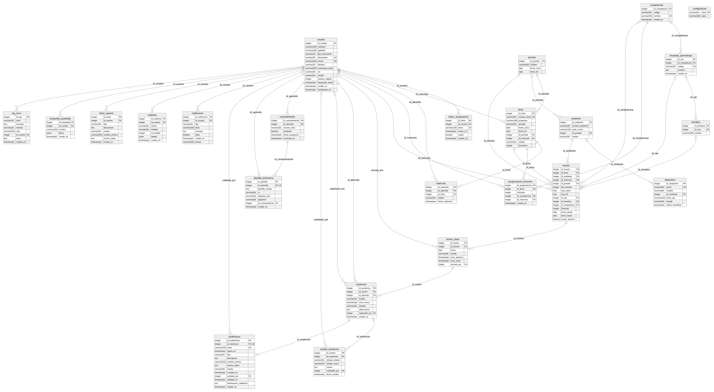
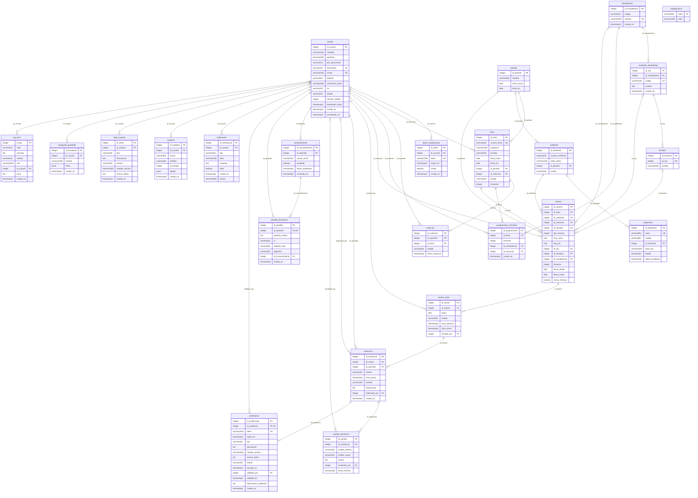

# Modelo relacional — AsistenciaApp SENA

Generado el 2026-11-17 directamente de la base en uso (PostgreSQL 16, base `asistenciaapp` del entorno en el puerto 8090).
El esquema de esa base coincide línea por línea con una instalación limpia de `db/init.sql` + `db/migraciones/001…010`.

**24 tablas · 173 columnas · 36 llaves foráneas · 22 reglas CHECK · 3 índices únicos parciales**

Para verlo fuera de GitHub (WhatsApp, Drive, Word): [PDF](09-Modelo-Relacional.pdf) · [página web en un solo archivo](09-Modelo-Relacional.html) · [PNG](09-Modelo-Relacional.png) · [SVG](09-Modelo-Relacional.svg). Historial de cambios: [10-Cambios-en-la-Base-de-Datos.md](10-Cambios-en-la-Base-de-Datos.md).

## Diagrama entidad-relación

*Haz clic en la imagen para abrirla en grande y acercarla. También está en [PDF](09-Modelo-Relacional.pdf).*

Notación pata de gallo: `||` exactamente uno, `|o` cero o uno, `o{` cero o muchos. PK = llave primaria, FK = llave foránea, UK = valor único.

Código Mermaid del diagrama (para editarlo o regenerarlo)

## Tablas por módulo

### Usuarios y seguridad

| Tabla | Columnas | Llave primaria | Llaves foráneas |
|---|---|---|---|
| `usuario` | 14 | id_usuario | — |
| `token_recuperacion` | 6 | id_token | id_usuario → usuario |
| `busqueda_guardada` | 5 | id_busqueda | id_usuario → usuario |

### Estructura académica

| Tabla | Columnas | Llave primaria | Llaves foráneas |
|---|---|---|---|
| `periodo` | 4 | id_periodo | — |
| `ficha` | 10 | id_ficha | id_periodo → periodo id_instructor → usuario |
| `matricula` | 5 | id_matricula | id_aprendiz → usuario id_ficha → ficha |
| `ambiente` | 5 | id_ambiente | id_periodo → periodo |
| `dispositivo` | 7 | id_dispositivo | id_ambiente → ambiente |

### Currículo (competencias)

| Tabla | Columnas | Llave primaria | Llaves foráneas |
|---|---|---|---|
| `competencia` | 4 | id_competencia | — |
| `resultado_aprendizaje` | 5 | id_rap | id_competencia → competencia |
| `tematica` | 3 | id_tematica | id_rap → resultado_aprendizaje |
| `programacion_trimestre` | 6 | id_programacion | id_ficha → ficha id_competencia → competencia id_instructor → usuario |

### Programación y asistencia

| Tabla | Columnas | Llave primaria | Llaves foráneas |
|---|---|---|---|
| `horario` | 15 | id_horario | id_ficha → ficha id_ambiente → ambiente id_instructor → usuario id_periodo → periodo id_rap → resultado_aprendizaje id_tematica → tematica id_competencia → competencia |
| `sesion_clase` | 7 | id_sesion | id_horario → horario cerrada_por → usuario |
| `asistencia` | 9 | id_asistencia | id_sesion → sesion_clase id_aprendiz → usuario registrado_por → usuario |
| `cambio_asistencia` | 7 | id_cambio | id_asistencia → asistencia cambiado_por → usuario |
| `justificacion` | 14 | id_justificacion | id_asistencia → asistencia validada_por → usuario |

### Biometría (Ley 1581/2012)

| Tabla | Columnas | Llave primaria | Llaves foráneas |
|---|---|---|---|
| `consentimiento` | 6 | id_consentimiento | id_aprendiz → usuario |
| `plantilla_biometrica` | 8 | id_plantilla | id_aprendiz → usuario id_consentimiento → consentimiento |

### Soporte, avisos y trazabilidad

| Tabla | Columnas | Llave primaria | Llaves foráneas |
|---|---|---|---|
| `notificacion` | 8 | id_notificacion | id_usuario → usuario |
| `auditoria` | 7 | id_auditoria | id_usuario → usuario |
| `log_error` | 8 | id_log | id_usuario → usuario |
| `ticket_soporte` | 8 | id_ticket | id_usuario → usuario |
| `configuracion` | 2 | clave | — |

## Relaciones (llaves foráneas)

| Tabla hija | Columna | Tabla padre | Cardinalidad (padre : hija) | Al borrar el padre |
|---|---|---|---|---|
| `token_recuperacion` | `id_usuario` | `usuario` | 1 : 0..N | CASCADE |
| `ficha` | `id_periodo` | `periodo` | 1 : 0..N | NO ACTION |
| `ficha` | `id_instructor` | `usuario` | 1 : 0..N | NO ACTION |
| `matricula` | `id_aprendiz` | `usuario` | 1 : 0..N | NO ACTION |
| `matricula` | `id_ficha` | `ficha` | 1 : 0..N | NO ACTION |
| `ambiente` | `id_periodo` | `periodo` | 0..1 : 0..N | NO ACTION |
| `dispositivo` | `id_ambiente` | `ambiente` | 0..1 : 0..N | NO ACTION |
| `resultado_aprendizaje` | `id_competencia` | `competencia` | 1 : 0..N | CASCADE |
| `tematica` | `id_rap` | `resultado_aprendizaje` | 1 : 0..N | CASCADE |
| `programacion_trimestre` | `id_ficha` | `ficha` | 1 : 0..N | CASCADE |
| `programacion_trimestre` | `id_competencia` | `competencia` | 1 : 0..N | CASCADE |
| `programacion_trimestre` | `id_instructor` | `usuario` | 1 : 0..N | NO ACTION |
| `horario` | `id_ficha` | `ficha` | 1 : 0..N | NO ACTION |
| `horario` | `id_ambiente` | `ambiente` | 1 : 0..N | NO ACTION |
| `horario` | `id_instructor` | `usuario` | 1 : 0..N | NO ACTION |
| `horario` | `id_periodo` | `periodo` | 1 : 0..N | NO ACTION |
| `horario` | `id_rap` | `resultado_aprendizaje` | 0..1 : 0..N | NO ACTION |
| `horario` | `id_tematica` | `tematica` | 0..1 : 0..N | NO ACTION |
| `horario` | `id_competencia` | `competencia` | 0..1 : 0..N | NO ACTION |
| `sesion_clase` | `id_horario` | `horario` | 1 : 0..N | NO ACTION |
| `sesion_clase` | `cerrada_por` | `usuario` | 0..1 : 0..N | NO ACTION |
| `asistencia` | `id_sesion` | `sesion_clase` | 1 : 0..N | NO ACTION |
| `asistencia` | `id_aprendiz` | `usuario` | 1 : 0..N | NO ACTION |
| `asistencia` | `registrado_por` | `usuario` | 0..1 : 0..N | NO ACTION |
| `cambio_asistencia` | `id_asistencia` | `asistencia` | 1 : 0..N | NO ACTION |
| `cambio_asistencia` | `cambiado_por` | `usuario` | 0..1 : 0..N | NO ACTION |
| `consentimiento` | `id_aprendiz` | `usuario` | 1 : 0..N | NO ACTION |
| `plantilla_biometrica` | `id_aprendiz` | `usuario` | 1 : 0..1 | NO ACTION |
| `plantilla_biometrica` | `id_consentimiento` | `consentimiento` | 1 : 0..N | NO ACTION |
| `justificacion` | `id_asistencia` | `asistencia` | 1 : 0..1 | NO ACTION |
| `justificacion` | `validada_por` | `usuario` | 0..1 : 0..N | NO ACTION |
| `notificacion` | `id_usuario` | `usuario` | 1 : 0..N | NO ACTION |
| `auditoria` | `id_usuario` | `usuario` | 0..1 : 0..N | NO ACTION |
| `ticket_soporte` | `id_usuario` | `usuario` | 1 : 0..N | NO ACTION |
| `busqueda_guardada` | `id_usuario` | `usuario` | 1 : 0..N | NO ACTION |
| `log_error` | `id_usuario` | `usuario` | 0..1 : 0..N | SET NULL |

## Reglas de integridad destacadas

- **Una huella por aprendiz:** `plantilla_biometrica.id_aprendiz` es único, y cada plantilla exige un `consentimiento` (Ley 1581/2012).
- **Una justificación por inasistencia:** `justificacion.id_asistencia` es único y su `token` también.
- **Una marca por aprendiz y clase:** `asistencia (id_sesion, id_aprendiz)` es único; la sesión es única por `(id_horario, fecha)`.
- **Un lector por ambiente:** índice único parcial `idx_dispositivo_ambiente_unico`; el `serial` del lector también es único.
- **Una matrícula activa por aprendiz:** índice único parcial `idx_matricula_activa_unica`.
- **Horarios sin duplicar:** `idx_horario_sin_duplicados` sobre ficha, día, horas y trimestre; además `hora_fin > hora_inicio`.
- **Estados controlados con CHECK:** asistencia (presente, tardanza, ausente, justificada), método (huella, manual, sistema), sesión (activa, cerrada), justificación, dispositivo, ficha, matrícula, usuario y rol.
- **Borrado en cascada solo en el currículo** (competencia → RAP → temática, programación) y en los tokens de recuperación; el resto de relaciones protege la historia de asistencia (NO ACTION).
